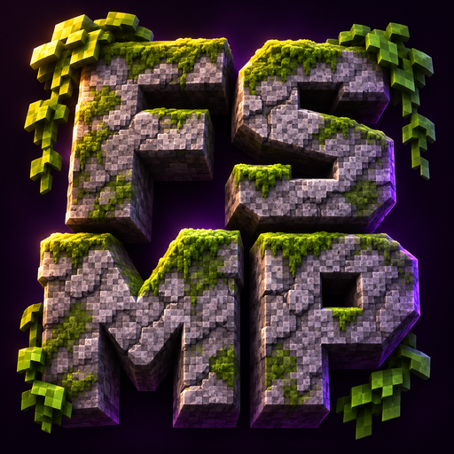

# Fracturepoint SMP — Farlands Anarchy

**A permanent Farlands anarchy SMP with restored Classic Far Lands, proximity voice chat, no wipes and no teleport commands.**

Escape ruined spawn, build a hidden stash and find your crew. Join **`fracturepoint.duckdns.org`** using **Minecraft Java 26.2**.

Fracturepoint opened November 8, 2026 at 10:01 PM Pacific and has no scheduled
world wipes. New arrivals spawn at random surface locations within a 2,000 by
2,000 area. PvP, griefing and raiding are part of the world, with no land claims,
homes, TPA, warps, Waystones or donor teleport shortcuts.

## Easy voice setup

**[Get the complete pack and follow the three-step setup](downloads/README.md).**

The pack is optional: you can join with normal Java 26.2. For voice and
managed updates, import it once in Prism Launcher or the Modrinth App,
join, and accept any requested pack download and restart. Press **V** for the
one-time microphone and talk-mode setup. Use the same profile next time for
managed updates; audio choices are saved. A plain Java client cannot install
mods just by joining. The guide explains quiet, muted and disconnected states.

## Explore the Far Lands and build your history

The world is roughly 60 million blocks across. Restored Classic Far Lands begin
around 12.55 million blocks from the center. Travel by normal portals and
player-built transportation, build highways and bases, raid rivals and leave
your mark in the permanent world.

## Cannons and long-distance travel

Learn about the shared Far Lands pearl launcher and orbital cannon, including
creator videos, original schematics and important differences in our setup: 
**[Cannon guide](guides/CANNONS.md)**.

## Launch duping

The launch item-duping event runs through **November 29, 2026 at 10:01 PM Pacific**.
Use `/guide` and `/duping` in game for the current instructions and event status.
Rare future official dupe events will celebrate community growth. Discovered
item dupes are patched between official events. TNT duplication remains allowed
for player-built mechanisms.

**[Join our Discord](https://discord.gg/Wy9r5aJ4EH)** for the dupe video, setup
guides and community. The same links are available through `/discord` and
**Pause → Server Links** in game.

## Find Fracturepoint on Minecraft server lists

Browse the screenshots, read the listing and use each site's free voting option if you want to help other players discover the server:

- [Planet Minecraft — Fracturepoint SMP](https://www.planetminecraft.com/server/fracturepoint-far-lands-anarchy/)
- [Minecraft-MP — Fracturepoint SMP](https://minecraft-mp.com/server-s366614)
- [MinecraftServers.org — Fracturepoint SMP](https://minecraftservers.org/server/695934)

Voting is optional. No purchase or vote is required to join or use the announced duplication event.

Older expedition/Waystones releases in this repository describe an earlier
project. Use the current starter linked above for the live permanent server.

